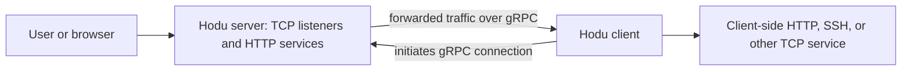

# Hodu

Hodu connects a server to clients over gRPC and forwards TCP connections to
services reachable from those clients. It also provides HTTP proxies, browser
PTY/SSH terminals, and remote command execution through client-side profiles.

## Contents

- [Architecture and terminology](#architecture-and-terminology)
- [Build](#build)
- [Quick start](#quick-start)
- [Listeners](#listeners)
- [Configuration](#configuration)
- [Routes and forwarding](#routes-and-forwarding)
- [Browser terminals](#browser-terminals)
- [Remote command execution](#remote-command-execution)
- [Authentication and protected tokens](#authentication-and-protected-tokens)
- [Operations and troubleshooting](#operations-and-troubleshooting)
- [Terminal WebSocket protocol](#terminal-websocket-protocol)

## Architecture and terminology

A Hodu client initiates the connection to the server. A route asks the server to
listen on an address and forward incoming connections through that client to a
target service.



| Term | Meaning |
|---|---|
| Connection ID (`conn-id`) | Identifier for a client/server connection, reported by the corresponding control API |
| Route ID (`route-id`) | Identifier for a forwarding route within a connection |
| Peer ID (`peer-id`) | Identifier for an individual forwarded TCP connection |
| Client token | Client-configured identifier used to select a connected client |
| Access token | RS256 JWT used to authenticate HTTP/WebSocket access |
| Job/run | An RXC job targets clients; each target has its own execution run |

Client tokens and access tokens serve different purposes. A protected client
token wraps the client identifier in an encrypted, time-limited document.

## Build

The module declares Go 1.22.0. Use a compatible Go toolchain, Make, and OpenSSL.
The current source uses Unix APIs for PTYs, polling, and process control.

```sh
make
./hodu version
make hodu.debug
make check
```

`hodu.debug` enables Go's race detector and requires CGO support. To run tests
with race detection directly:

```sh
go test -race ./...
```

The Makefile generates missing development certificates and an RSA key under
`cmd/`. For deployments, configure your own certificates and keys.

### Rebuild the browser terminal

Node.js and npm are needed when rebuilding the terminal assets:

```sh
npm install
make xterm.html
make
```

Vite reads `xterm-plain.html` and its module entry `xterm-plain.js`, bundles
xterm and its addons, and produces the single-file `xterm.html`. The Go binary
embeds that file, so rebuild the binary after changing it.
`npm run build:xterm` alone writes to the temporary `.vite-xterm/` directory;
`make xterm.html` also copies the result into the repository root.

Protobuf Go sources are already included. If you change `hodu.proto`, install
`protoc`, `protoc-gen-go`, and `protoc-gen-go-grpc`, then regenerate with:

```sh
make hodu.pb.go hodu_grpc.pb.go
```

## Quick start

These examples run everything on one machine, without TLS or HTTP
authentication, using loopback listeners. Open separate terminals for the
long-running commands.

1. Start an HTTP service on the **client machine**:

   ```sh
   python3 -m http.server 1212 --bind 127.0.0.1
   ```

2. Start the **Hodu server**:

   ```sh
   ./hodu server \
     --rpc-on=127.0.0.1:9999 \
     --ctl-on=127.0.0.1:8888 \
     --pxy-on=127.0.0.1:9998 \
     --wpx-on=127.0.0.1:9997 \
     --rpx-on=127.0.0.1:9996
   ```

3. Start the **Hodu client** and create an HTTP route:

   ```sh
   ./hodu client \
     --rpc-to=127.0.0.1:9999 \
     --ctl-on=127.0.0.1:1107 \
     --client-token=demo-client \
     --rpx-target-addr=127.0.0.1:1212 \
     "127.0.0.1:1212,127.0.0.1:12346,http,Demo HTTP"
   ```

4. Verify forwarding from the **server machine**:

   ```sh
   # Direct TCP forwarding through the route.
   curl http://127.0.0.1:12346/

   # WPX selects the route by its listening port.
   curl http://127.0.0.1:9997/12346/

   # RPX selects the client by its token and uses its RPX target.
   curl -H 'Host: demo-client' http://127.0.0.1:9996/

   # Inspect assigned connection and route IDs.
   curl 'http://127.0.0.1:8888/_ctl/server-conns?routes=true'
   ```

For separate machines, bind the server RPC listener to an address reachable by
the client and use that address in `--rpc-to`. A client target such as
`127.0.0.1:1212` refers to the client's machine; a route binding such as
`127.0.0.1:12346` refers to the server's machine.

## Listeners

Ports below are example choices, not automatic defaults. Enable only the
listeners you need.

| Service | Server option | Example port | Purpose |
|---|---|---|---|
| RPC | `--rpc-on` | 9999 | gRPC transport from Hodu clients |
| CTL | `--ctl-on` | 8888 | Administrative API, metrics, events, terminals, and RXC |
| ECT | `--ect-on` | 8889 | Separate listener for local and remote PTY pages/WebSockets |
| RPX | `--rpx-on` | 9996 | HTTP proxy selected by client token |
| PXY | `--pxy-on` | 9998 | HTTP/SSH proxy selected by connection and route |
| WPX | `--wpx-on` | 9997 | HTTP/SSH proxy selected by route listening port |

The client has its own `--ctl-on` listener for client administration and local
PTY access. Its `--rpc-to` addresses identify Hodu servers.

ECT exposes `/_pty/*` and `/_rpty/*`, with its own TLS and HTTP authentication
configuration. It does not expose the full CTL API.

## Configuration

Configuration files use YAML. The supported fields are defined in
[`cmd/config.go`](cmd/config.go).

### Minimal server configuration

Save as `server.yaml`:

```yaml
app:
  pty-shell: /bin/sh
  rxc-done-job-retention: 60s
  rxc-run-output-max: 4096
rpc:
  service:
    addresses: ["127.0.0.1:9999"]
ctl:
  service:
    addresses: ["127.0.0.1:8888"]
pxy:
  service:
    addresses: ["127.0.0.1:9998"]
wpx:
  service:
    addresses: ["127.0.0.1:9997"]
rpx:
  service:
    addresses: ["127.0.0.1:9996"]
```

```sh
./hodu server --config-file=server.yaml
```

### Minimal client configuration

Save as `client.yaml`:

```yaml
app:
  token-text: demo-client
  pty-shell: /bin/sh
  rxc-profile-files: ["./profiles.d/*.yaml"]
  rxc-profile-reload-min-interval: 5s
rpc:
  endpoint:
    addresses: ["127.0.0.1:9999"]
ctl:
  service:
    addresses: ["127.0.0.1:1107"]
rpx:
  target:
    address: "127.0.0.1:1212"
```

Routes are positional command-line arguments or control API resources:

```sh
./hodu client --config-file=client.yaml \
  "127.0.0.1:1212,127.0.0.1:12346,http,Demo HTTP"
```

### Loading and overrides

- `--config-file` loads the primary file.
- `--config-file-pattern='./conf.d/*.yaml'` loads additional matching files in
  lexical order into the configuration. Quote patterns to prevent shell
  expansion. Do not assume list fields are concatenated.
- Explicit command-line listener/endpoint lists replace their YAML address
  lists. Repeat `--ctl-on`, `--rpc-on`, `--rpc-to`, or other listener flags to
  supply multiple addresses.
- `--pty-shell`, `--log-file`, `--client-token`, and `--rpx-target-addr`
  override the corresponding configured values.
- Repeated `--rxc-profile-files` flags replace the configured profile-pattern
  list. `app.token-text` takes precedence over `app.token-file`.
- Relative paths are resolved from the process working directory.

Use explicit duration units such as `500ms`, `30s`, and `5m`.
Token TTL and route-lifetime parsers also accept numeric seconds.

### TLS

Each server service has a `tls` section. For example, under `rpc` in the
server configuration:

```yaml
rpc:
  service:
    addresses: ["0.0.0.0:9999"]
  tls:
    enabled: true
    cert-file: ./server.crt
    key-file: ./server.key
```

The matching client settings are:

```yaml
rpc:
  endpoint:
    addresses: ["server.example.com:9999"]
  tls:
    enabled: true
    server-name: server.example.com
    server-ca-cert-file: ./ca.crt
```

For mutual TLS, supply client `cert-file` and `key-file`, and configure the
server's `client-ca-cert-file` and
`client-auth-type: RequireAndVerifyClientCert`. Server TLS also supports
`cert-text`/`key-text` and SNI certificate selection through `snis` entries
containing `name-regex`, `cert-file`, and `key-file`.

TLS for the client-to-server RPC connection is separate from TLS for a proxied
HTTP target (`rpx.target.tls` on the client or `pxy.target.tls` on the server).

## Routes and forwarding

The client route syntax is:

```text
client-target-address,server-listening-address,type,description
```

Addresses include ports. The final type and description fields are optional.
Supported explicit types are `ssh`, `http`, `https`, and `auto`; omitting
the type leaves a generic TCP route. `auto` recognizes target ports 22, 80, and
443. Quote each route argument, especially when descriptions contain spaces.
Commas are field separators and cannot appear inside a description.

```sh
# SSH target on the client; TCP listener on the server.
./hodu client --rpc-to=127.0.0.1:9999 --client-token=demo-client \
  "127.0.0.1:22,127.0.0.1:12345,ssh,Demo SSH"

# IPv6 addresses use brackets.
./hodu client --rpc-to='[::1]:9999' \
  "[::1]:1212,[::1]:12346,http,IPv6 HTTP"
```

Use port `0` in the server listening address to request a dynamically assigned
port, then retrieve the actual address through the control API.

### HTTP and SSH access

Use the IDs reported by `/_ctl/server-conns?routes=true`:

| Access | Example |
|---|---|
| Direct HTTP forwarding | `http://127.0.0.1:12346/` |
| PXY HTTP | `http://127.0.0.1:9998/_http/{conn_id}/{route_id}/` |
| WPX HTTP | `http://127.0.0.1:9997/12346/` |
| PXY SSH terminal | `http://127.0.0.1:9998/_ssh/{conn_id}/{route_id}/xterm.html` |
| WPX SSH terminal | `http://127.0.0.1:9997/_ssh/12345/xterm.html` |

For a raw SSH client, use `ssh -p 12345 user@127.0.0.1`.

RPX does not require a forwarding route: it sends requests to the selected
client's `rpx.target.address`. By default, selection uses the HTTP Host value.
Set `rpx.client-token.attr-name` to select by a header instead. Optional
`regex` and `submatch-index` settings extract the token from that value.

### Manage routes through the client control API

First obtain the client-side connection ID:

```sh
curl http://127.0.0.1:1107/_ctl/client-conns
```

Save this as `client-route.json`:

```json
{
  "route-id": 0,
  "client-peer-addr": "127.0.0.1:22",
  "client-peer-name": "Demo SSH",
  "server-peer-option": "tcp4 ssh",
  "server-peer-svc-addr": "127.0.0.1:0",
  "server-peer-svc-net": "127.0.0.0/8",
  "lifetime": "10m"
}
```

`route-id: 0` requests automatic ID assignment. The example expires after
10 minutes; `lifetime: "0"` instead creates a route without a lifetime expiry.
Lifetime updates require a route created with a positive lifetime.
`server-peer-svc-net` restricts source networks accepted by the route.

Replace example connection ID `1` and route ID `2` with the returned values:

```sh
curl -X POST -H 'Content-Type: application/json' \
  --data-binary @client-route.json \
  http://127.0.0.1:1107/_ctl/client-conns/1/routes

curl http://127.0.0.1:1107/_ctl/client-conns/1/routes

curl -X PUT -H 'Content-Type: application/json' \
  -d '{"lifetime":"20m"}' \
  http://127.0.0.1:1107/_ctl/client-conns/1/routes/2

curl -X DELETE http://127.0.0.1:1107/_ctl/client-conns/1/routes/2
```

## Browser terminals

Set `app.pty-shell` or `--pty-shell` to the program used for local and remote
PTY access. `app.pty-user` selects the operating-system user where configured.

| Terminal | URL using the example ports |
|---|---|
| Shell on the server | `http://127.0.0.1:8888/_pty/xterm.html` |
| Shell on the client, through the server | `http://127.0.0.1:8888/_rpty/xterm.html?client-token=demo-client` |
| Shell on the client, directly | `http://127.0.0.1:1107/_pty/xterm.html` |

SSH terminal URLs are listed in the forwarding section. Enter the target SSH
username and password in the login form.

Use **Split side by side** or **Split stacked** to split the selected panel.
Drag a divider to resize it; a focused divider also accepts arrow keys. Each
panel has independent input, terminal dimensions, and a **Close** button.
**Disconnect** closes every session on that page.

A page supports up to 32 sessions over one WebSocket, all using the same terminal
type and target. SSH panels share an SSH connection when credentials match.
Closing one panel or exiting its shell leaves the other panels running.

For PTY and RPTY, add `autoconnect=1` or `autoconnect=true` to skip the initial
Connect prompt:

```text
http://127.0.0.1:8888/_rpty/xterm.html?client-token=demo-client&autoconnect=1
```

A failed initial attempt shows the Connect prompt for manual retry. Without
the parameter, connection is manual. SSH always shows its login form.

## Remote command execution

RXC runs a configured client-side executable through a server HTTP API.
The current client supports `type: "simple"`; it resolves the first word of
`script` as a profile name. Unknown profiles fail rather than executing an
arbitrary program name.

### Client profiles

Create `profiles.d/common.yaml` on the client:

```yaml
profiles:
  - name: uptime
    script: /usr/bin/uptime
    args: []
  - name: print
    script: /usr/bin/printf
    args:
      - '%s\n'
      - '${1}'
  - name: reorder
    script: /usr/bin/printf
    args:
      - '%s %s\n'
      - '${2}'
      - 'abc${1}'
```

Configure `app.rxc-profile-files` as in the client YAML, or use:

```sh
./hodu client --rpc-to=127.0.0.1:9999 --client-token=demo-client \
  --rxc-profile-files='./profiles.d/*.yaml'
```

Profiles from all matching files are merged; names must be unique across files.
The profile `script` is an executable path, not a shell command line.
An optional profile `user` overrides `app.rxc-user`. If both are omitted,
execution uses the client's operating-system identity.

Profile files load lazily during lookup. Checks are throttled by
`app.rxc-profile-reload-min-interval` (default `5s`). File additions,
deletions, and modification-time/size changes trigger a reload at a subsequent
lookup. A nonpositive interval checks on every lookup. A failed reload leaves
the previous cache available, so an already-cached matching profile can still
execute.

### Arguments

The incoming command is split with quoting and backslash handling, without
shell expansion, pipelines, or redirection. The remaining words become the
profile's input arguments.

| Profile `args` | Behavior |
|---|---|
| Omitted | Pass the original input arguments unchanged |
| `[]` | Pass no arguments |
| Nonempty list | Expand each template into one argument |
| `${1}`, `${2}`, ... | Substitute positional input arguments; a missing argument expands to empty text |
| Whole item `${@}` | Insert all original input arguments as separate arguments |

Template results are not split again, so arguments containing spaces retain
their boundaries. For example, `reorder first "second value"` passes
`["%s %s\\n", "second value", "abcfirst"]` to `/usr/bin/printf`.

### Submit and inspect jobs

Submit to the **server CTL port**, not the client CTL or RPC port:

```sh
curl -X POST http://127.0.0.1:8888/_rxc \
  -H 'Content-Type: application/json' \
  -d '{"clients":["demo-client"],"type":"simple","script":"print \"hello world\""}'
```

The response is `202 Accepted` and includes `job-id`. Omit `clients` or use
an empty list to target a snapshot of all currently connected clients. A
nonempty list accepts connection IDs as strings or nonnumeric client tokens.
Each target executes independently.

Use the returned job ID and each run's `conn-id`:

```sh
curl http://127.0.0.1:8888/_rxc
curl http://127.0.0.1:8888/_rxc/1
curl 'http://127.0.0.1:8888/_rxc/1/runs?output=true'
curl http://127.0.0.1:8888/_rxc/1/runs/1
```

Run lists omit output unless `output=true` or `output=1` is requested.
Individual-run GET responses include captured output. Nonempty `stdout` and
`stderr` fields are base64-encoded; empty fields can be omitted. With `jq`
installed, decode stdout with:

```sh
curl -sS http://127.0.0.1:8888/_rxc/1/runs/1 \
  | jq -r '.stdout // ""' | base64 --decode
```

Runs report `starting`, `running`, `stopping`, `stopped`, or `failed`.
`exit-code` reports a normal process exit code, or `-1` when none is
available. `stop-msg` provides additional information.

### Stop, delete, and retain

| Method and path | Action |
|---|---|
| `POST /_rxc/{job_id}/stop` | Request stop for all runs |
| `POST /_rxc/{job_id}/runs/{conn_id}/stop` | Request stop for one run |
| `DELETE /_rxc/{job_id}` | Delete a completed job record |
| `DELETE /_rxc/{job_id}/runs/{conn_id}` | Delete a completed run record |

Deleting an active job/run returns `409 Conflict`. Deleting a run removes it
from the job's retained counts. Records and captured output are held in memory.

| Server setting | Default | Meaning |
|---|---|---|
| `app.rxc-done-job-retention` | `60s` | Automatically purge completed jobs after this interval; nonpositive disables automatic purge |
| `app.rxc-run-output-max` | `1024` | Maximum captured bytes per stream per run; nonpositive disables capture |

Capture retains the beginning of stdout and stderr. The corresponding
`stdout-truncated`/`stderr-truncated` flags indicate discarded output.

## Authentication and protected tokens

### HTTP authentication

Enable authentication separately for CTL, ECT, PXY, and WPX through each
service's `auth` block. For example, merge this into the server's `ctl`
configuration:

```yaml
ctl:
  service:
    addresses: ["127.0.0.1:8888"]
    auth:
      enabled: true
      realm: hodu
      credentials: ["admin:replace-this-password"]
      token-ttl: 1h
      token-rsa-key-file: ./private.pem
```

Create a PKCS#1 RSA private key and its public key:

```sh
openssl genrsa -traditional -out private.pem 2048
openssl rsa -in private.pem -pubout -out public.pem
```

Use Basic authentication to obtain an access JWT:

```sh
curl -u admin:replace-this-password http://127.0.0.1:8888/_ctl/token
```

The response contains `access-token`. Pass it to HTTP APIs as
`Authorization: Bearer TOKEN`. Browser terminal URLs can use
`access-token=TOKEN`, alongside `client-token` for RPTY.

The reference shell helper also generates RS256 access JWTs:

```sh
bash jwt-rsa-256.sh generate private.pem
bash jwt-rsa-256.sh generate private.pem 600
```

Its default TTL is 3600 seconds. Use the same signing key as the listener's
authentication configuration.

Authentication also supports ordered `access-rules` with `prefix`,
`origin-networks`, and actions `accept`, `reject`, `auth-required`, or
`cert-required`. Origin-network matching uses the direct remote address.
Use configured deployment keys, service authentication, and TLS for externally
accessible services.

### Protected RPX and RPTY client tokens

For RPX, merge this into the server configuration:

```yaml
rpx:
  service:
    addresses: ["127.0.0.1:9996"]
  client-token:
    attr-name: X-Client-Token
    protection: rsa-aes-256-gcm
    token-rsa-key-file: ./private.pem
    token-ttl: 30s
```

For RPTY, the equivalent protection settings belong under
`ctl.rpty.client-token`. They also govern RPTY access through ECT.

Generate a protected document using either reference implementation:

```sh
python3 rsa-aes-256-gcm.py encipher public.pem demo-client 30
php rsa-aes-256-gcm.php encipher public.pem demo-client 30
```

The Python helper requires the `cryptography` package; the PHP helper uses
PHP's OpenSSL extension. Both default to a 30-second TTL when omitted.
Their `decipher private.pem DOCUMENT` commands validate and display the
decoded token and timestamps.

Send the generated document in RPX's configured header:

```sh
curl -H 'X-Client-Token: PROTECTED_DOCUMENT' http://127.0.0.1:9996/
```

For RPTY, use it as the `client-token` query parameter. An authenticated
server CTL request can also issue documents through:

```text
GET /_ctl/token?type=client-token&endpoint=rpx&source=demo-client
GET /_ctl/token?type=client-token&endpoint=rpty&source=demo-client
```

Issuance requires CTL authentication to be enabled and a positive token TTL
for the selected endpoint.

The format is:

```text
plaintext = b64url(token)|iat|exp
ciphertext = AES-256-GCM(plaintext), including the authentication tag
encrypted-aes-key = RSA-OAEP-SHA256(random AES key)
document = b64url(encrypted-aes-key).b64url(nonce).b64url(ciphertext)
```

Base64url segments are unpadded. `iat` and `exp` are Unix seconds and are
validated after decryption. Documents remain reusable within their validity
window; there is no one-time-use replay cache.

## Operations and troubleshooting

### Inspection, logs, and events

Useful server endpoints:

```sh
curl http://127.0.0.1:8888/_ctl/server-conns
curl http://127.0.0.1:8888/_ctl/server-routes
curl http://127.0.0.1:8888/_ctl/server-peers
curl http://127.0.0.1:8888/_ctl/stats
curl http://127.0.0.1:8888/_ctl/metrics
```

The client has corresponding `/_ctl/client-conns`, `client-routes`,
`client-peers`, `stats`, and `metrics` endpoints on its own CTL port.

Logs go to stderr unless `app.log-file` or `--log-file` is set. Configure
`app.log-mask` with `debug`, `info`, `warn`, `error`, `all`, or `none`;
`app.log-max-size` and `app.log-rotate` control file rotation.

The server event socket is `ws://127.0.0.1:8888/_ctl/events` (use `wss`
with TLS). It emits JSON envelopes with a numeric `type` and a `data`
payload. Events cover connection, route, and peer changes, plus
`SERVER_EVENT_RXC_JOB_RUN_DONE` and `SERVER_EVENT_RXC_JOB_DONE`.
Run completion events omit captured output; job completion follows the final
run completion event. Retrieve output through the RXC API.

`ctl.service.prefix` prefixes the server's built-in `/_ctl/*` routes,
including events. The built-in `/_pty`, `/_rpty`, and `/_rxc` paths remain
at the root. The client event socket is currently registered at `/_ctl/events`.

Stop foreground processes with Ctrl+C to request shutdown.

### Common problems

| Symptom | Check |
|---|---|
| Client cannot connect | RPC listener/address, firewall reachability, and matching TLS/CA settings |
| Forwarded service is unreachable | Target address on the client, actual server route binding, and permitted source network |
| HTTP API returns 401/403 | The selected listener's auth configuration, credentials, access rules, and token timestamps |
| RPTY reports an unknown client | Connected client token, token protection settings, and document expiry |
| RXC reports an unknown profile | Client profile glob, working directory, exact profile name, reload interval, and YAML validity |
| RXC output appears missing | Use `?output=true`, decode base64 fields, and check output capture limits |
| SSH login fails | Target SSH service, route IDs/port, username, and password |
| Browser shows old terminal behavior | Rebuild `xterm.html` and the binary, restart the process, and check `app.xterm-html-file` overrides |

## Terminal WebSocket protocol

PTY and SSH terminal messages use JSON with an optional string `session` ID:

```json
{"session":"1","type":"open","data":["",""]}
{"session":"1","type":"iov","data":["aGVsbG8K"]}
{"session":"1","type":"size","data":["30","100"]}
{"session":"1","type":"close","data":[]}
```

For SSH, `open.data` contains the username and password. PTY uses two empty
strings. `iov` data is base64-encoded terminal bytes; size values are rows,
then columns. Responses carry the same session ID with `iov`, `status`
(`opened`/`closed`), or `error`.

Session IDs are scoped to a WebSocket. Closing an identified session leaves
the socket and other sessions open. Omitting `session` retains the legacy
single-session lifecycle. The RPTY gRPC messages retain their existing format.
